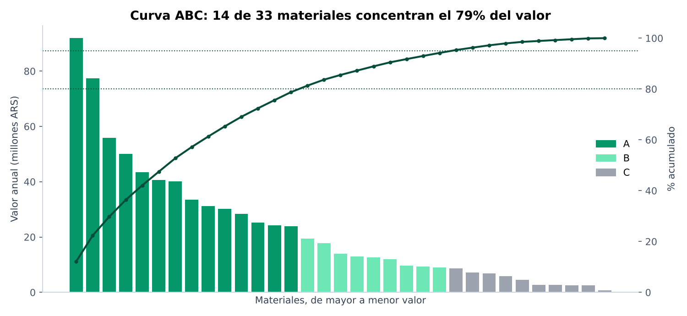
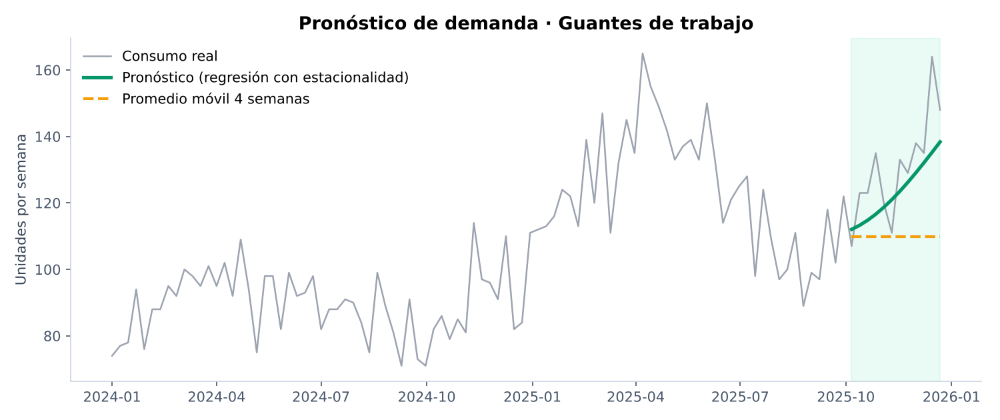

# Análisis de abastecimiento y stock

Proyecto de Data Science de **LuSan PRO**: responde cuatro preguntas que cualquier área de compras o abastecimiento se hace todas las semanas.

1. **¿Qué materiales concentran el gasto?** Curva ABC por valor consumido.
2. **¿Cuánto se va a consumir?** Pronóstico de demanda semanal (regresión con tendencia y estacionalidad, comparada contra un promedio móvil).
3. **¿Cuándo y cuánto pedir?** Stock de seguridad y punto de pedido con nivel de servicio del 95%, y lista de alertas de reposición.
4. **¿Qué proveedores cumplen?** Porcentaje de entregas a tiempo y demora media.

👉 **Ver el tablero:** https://hernanarana.github.io/analisis-abastecimiento/

> Los datos son **simulados** (33 materiales, 104 semanas de consumo y 791 pedidos de compra), generados con semilla fija para que el análisis sea reproducible. No corresponden a ninguna empresa real.

## Resultados

| | |
| --- | --- |
| Materiales clase A | 14 de 33 concentran el 79% del valor |
| Error de pronóstico | 11% con regresión vs 16% con promedio móvil |
| Para reponer | 16 materiales (2 críticos) |
| Proveedores | del 91% al 4% de entregas a tiempo |




## Cómo correrlo

```bash
pip install pandas numpy scikit-learn matplotlib openpyxl
python src/generar_datos.py   # crea data/*.csv
python src/analisis.py        # gráficos en img/ y reporte Excel en reporte/
python src/dashboard.py       # arma index.html
```

## Estructura

```
data/      datos simulados (materiales, consumos semanales, pedidos de compra)
src/       generación de datos, análisis y tablero
img/       gráficos
reporte/   reporte_abastecimiento.xlsx (alertas, ABC, punto de pedido, proveedores)
```

Hecho por [Hernán Arana · LuSan PRO](https://hernanarana.github.io) con Python, pandas, scikit-learn y matplotlib.
